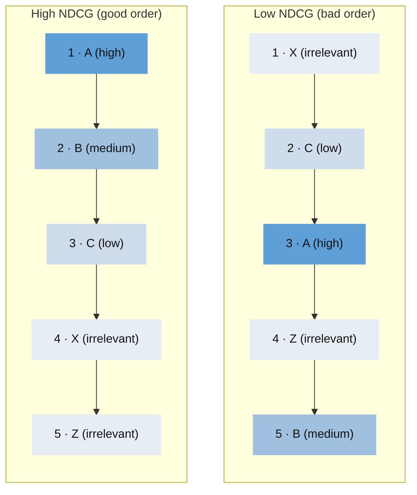
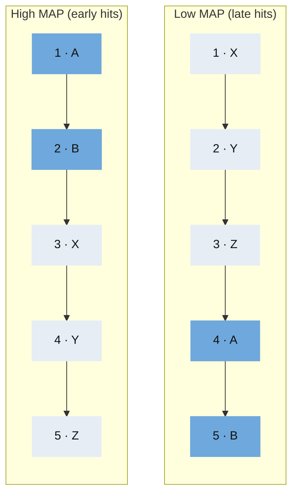
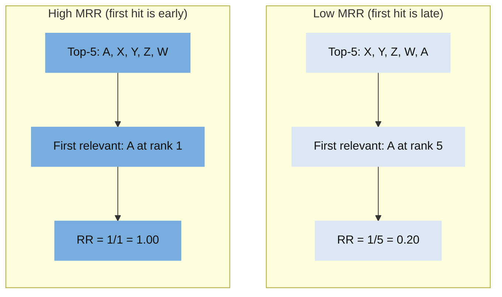
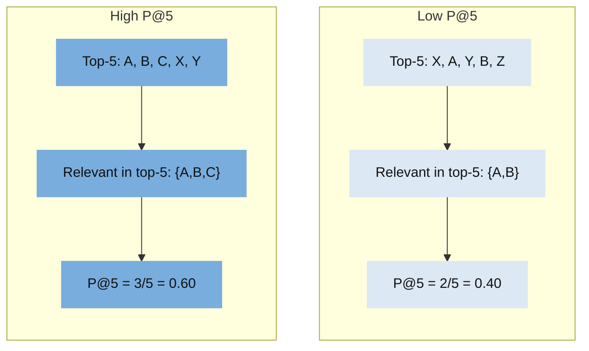
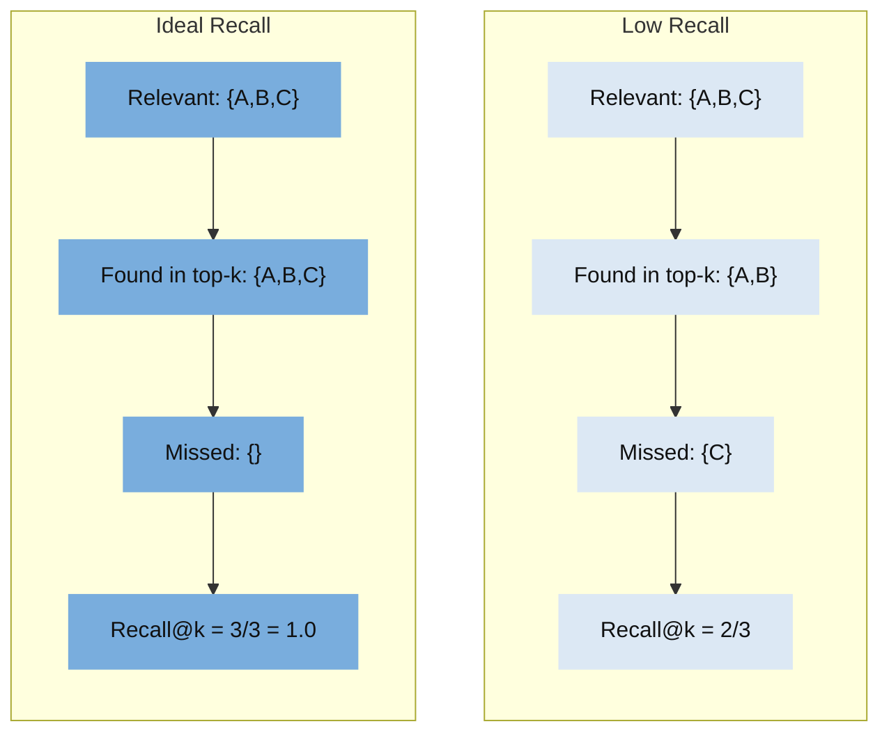

# Search Benchmark (Manticore + Qdrant + Meilisearch + OpenSearch)

This CLI benchmarks retrieval quality and performance on IR datasets across:
- Manticore full-text (`MATCH(...)`)
- Manticore vector (`FLOAT_VECTOR` + auto-embeddings)
- Qdrant full-text-like sparse retrieval (BM25 in Qdrant sparse vectors)
- Qdrant dense vector retrieval (vectors sourced from Manticore)
- Meilisearch lexical search
- Meilisearch vector search (user-provided vectors from the shared cache)
- Meilisearch hybrid search (query text + cached query vector)
- OpenSearch lexical search
- OpenSearch vector search (user-provided vectors from the shared cache)
- OpenSearch hybrid search (query text + cached query vector)

It produces reproducible artifacts (`metrics.json`, `per_query.csv`, `summary.md`, diagnostics) per run.

## Dataset

- Default source: `beir/trec-covid` via `ir_datasets`.
- Additional ready examples: `beir/nfcorpus/test`, `msmarco-passage/dev/small`, `msmarco-passage/trec-dl-2019/judged`, `msmarco-passage/trec-dl-2020/judged`, `hf-beir:theatticusproject/acord:test`.
- Dataset catalogs/docs:
  - [ir-datasets.com](https://ir-datasets.com/)
  - [ACORD on Hugging Face](https://huggingface.co/datasets/theatticusproject/acord)
- Corpus: COVID-19 research documents with `title` and `abstract` fields.
- Queries: official TREC-COVID topics.
  - TREC-COVID topics include multiple text variants (a shorter title-style query and longer descriptive text).
  - Benchmark query policy:
    - full-text-like modes (`manticore fulltext`, `qdrant fulltext`, `meilisearch fulltext`, `opensearch fulltext`) use the shorter query variant.
    - vector/hybrid modes (`manticore vector`, `qdrant vector`, `meilisearch vector`, `meilisearch hybrid`, `opensearch vector`, `opensearch hybrid`) use the longer query variant.
  - Prepared topic fields are explicit: `query_short` and `query_long`.
  - Example topics from TREC-COVID:
    - Topic `1`
      - short: `coronavirus origin`
      - long: `seeking range of information about the SARS-CoV-2 virus's origin, including its evolution, animal source, and first transmission into humans`
    - Topic `2`
      - short: `coronavirus response to weather changes`
      - long: `seeking range of information about the SARS-CoV-2 virus viability in different weather/climate conditions as well as information related to transmission of the virus in different climate conditions`
- Judgments: official TREC-COVID qrels (query-document relevance labels) used for quality metrics.
  - Labels are graded relevance values from the dataset qrels.
  - Metric interpretation in this benchmark:
    - `ndcg@k`: uses graded relevance values directly.
    - `map@k` and `recall@k`: treat documents with relevance `> 0` as relevant.
  - Qrels are filtered to the prepared document set.

Prepared outputs (source-scoped):
- `data/prepared/<source-slug>/docs.jsonl`
- `data/prepared/<source-slug>/topics.jsonl`
- `data/prepared/<source-slug>/qrels.tsv`

Examples:
- `beir/trec-covid` -> `data/prepared/beir-trec-covid/`
- `beir/nfcorpus/test` -> `data/prepared/beir-nfcorpus-test/`
- `msmarco-passage/dev/small` -> `data/prepared/msmarco-passage-dev-small/`
- `hf-beir:theatticusproject/acord:test` -> `data/prepared/hf-beir-theatticusproject-acord-test/`

Hugging Face BEIR-style sources:
- format: `hf-beir:<repo_id>:<split>`
- current example in this repo: `hf-beir:theatticusproject/acord:test`
- the loader expects a BEIR-style zip containing `corpus.jsonl`, `queries.jsonl`, and `qrels/<split>.tsv`

Note:
- Legacy prepared topic formats are no longer supported. If you have old prepared files, rerun `bench prepare`.

### MSMARCO Profiles

Recommended MSMARCO passage profiles in this repo:
- default benchmark: `msmarco-passage/dev/small`
- practical cheaper variant: `msmarco_lite_*` entries (`max_docs: 250000`, deterministic subset)
- secondary validation: `msmarco-passage/trec-dl-2019/judged`, `msmarco-passage/trec-dl-2020/judged`

Why this split:
- `dev/small` gives a practical judged query set for day-to-day tuning.
- TREC-DL judged sets provide higher-quality secondary validation on a small query set.

Runtime note:
- all of these still use the full MSMARCO passage corpus (~8.84M passages), so indexing/embedding remains heavy.
- `msmarco_lite_*` entries reduce this by limiting prepared docs (`dataset.max_docs`) while still keeping judged docs (`dataset.keep_qrels_docs: true`).

Example commands:
```bash
bench --config config.yaml prepare
bench --config config.yaml run --engine manticore --mode both --entry msmarco_passage_manticore
bench --config config.yaml run --engine manticore --mode both --entry msmarco_lite_manticore
bench --config config.yaml run --engine manticore --mode both --entry msmarco_trecdl_2019_manticore
bench --config config.yaml run --engine manticore --mode both --entry msmarco_trecdl_2020_manticore
```

### ACORD Profiles

Ready ACORD entries in this repo:
- `acord_manticore_ft`: Manticore full-text with lemmatization and `OR` query mode
- `acord_manticore_1bit`: Manticore vector with 1-bit quantization
- `acord_qdrant_ft`: Qdrant BM25
- `acord_qdrant_bq`: Qdrant dense with binary quantization

Prepared ACORD test split observed in this repo:
- docs: `3,931`
- queries: `57`
- qrels: `61,988`

## How It Works and Usage

Run `bench`, then choose the action in the interactive menu.

```bash
bench
```

Main actions:
1. `prepare`: choose one or more dataset sources and download/prepare corpus/topics/qrels.
2. `index`: build search indexes/tables for selected engine+mode (opens interactive index matrix when selected from `bench`; prints live indexing progress with `processed/total`, percent, inserted rows, retries/failures, elapsed seconds).
3. `run`: execute topic queries with fixed benchmark settings and compute metrics (opens interactive run matrix; variants come from named config profiles and include `PROFILE`, `ENGINE`, `MODE`, `MODEL/OPTS`).
4. `report`: render a combined report from selected artifacts.

Interactive menu controls: `↑/↓`, `ENTER`, `ESC/q` (and `SPACE` where multi-select is available).

Note:

The index selector combines options discovered from all local `config*.yaml` files (excluding templates).

`prepare` also supports direct filtering:
- `bench --config config.yaml prepare --source msmarco-passage/dev/small`
- `bench --config config.yaml prepare --entry msmarco_lite_manticore`

## Installation

Requirement: Python `3.11+`.

```bash
python3 -m venv .venv
source .venv/bin/activate
pip install -e '.[dev]'
```

Steps:
1. `python3 -m venv .venv` creates an isolated Python 3 environment in `.venv` for this project.
2. `source .venv/bin/activate` activates that environment so `python`/`pip` point to project-local tools.
3. `pip install -e '.[dev]'` installs this project in editable mode plus dev dependencies (for example `pytest`), so code changes are picked up immediately without reinstall.

Notes:
- On some systems `python` points to Python 2; use `python3`.
- In `zsh`, quote `'.[dev]'` to avoid shell glob expansion.

Unit tests:
```bash
./.venv/bin/pytest -q tests/unit
```
They validate core benchmark logic (for example metric calculations and run/report matrix behavior) without requiring live Manticore/Qdrant/Meilisearch services.

## Configuration

Config included in the repo:
- `config.yaml`: single source of truth.

`config.yaml.template` is kept as a documented reference with inline comments for all options.

### Embedding API Credentials
- in `config.yaml` under `manticore`:
  - `vector_api_key: "..."` (inline), or
  - `vector_api_key_file: "/absolute/path/to/keyfile"` (recommended).

Example:
```yaml
manticore:
  vector_model: "openai/text-embedding-3-large"
  vector_api_key_file: "/Users/you/openai_key.txt"
```

### Manticore Full-Text Ranking Config
- `manticore.fulltext_options`: raw Manticore RT table options appended to `CREATE TABLE ... )`.
  - default: `morphology='stem_en' index_field_lengths='1'`
  - example: `index_field_lengths='1' stopwords='en' morphology='lemmatize_en_all'`
- `manticore.search_options`: raw SQL `OPTION` list appended to Manticore search queries (including ranker settings).
  - default: `ranker=expr('1000*(bm25a(1.2,0.75)+sum(lcs*user_weight))')`
  - examples: `ranker=bm25`, `ranker=proximity_bm25`, `ranker=bm25, fuzzy=1`
  - applies to both full-text and vector query paths
- `manticore.fulltext_query_mode`: how full-text query terms are combined before sending them to `MATCH()`.
  - `and` (default): implicit Manticore `AND`
  - `or`: joins terms with `|`
  - `quorum`: uses Manticore quorum syntax like `"term1 term2 term3"/0.5`
- `manticore.fulltext_query_quorum`: quorum threshold used when `fulltext_query_mode: "quorum"` (default: `0.5`)
- full-text queries also set: `idf='plain,tfidf_unnormalized'`

### Manticore Vector Quantization/Search Config
- `manticore.vector_quantization`: `""` (off), `8bit`, `1bit`, or `1bitsimple`
- `manticore.vector_search_oversampling`: KNN query oversampling factor
- `manticore.vector_search_rescore`: `1`/`0` to enable/disable rescoring

### Qdrant Dense Quantization/Search Config
- `qdrant.dense_binary_quantization`: enable binary quantization for dense collection
- `qdrant.dense_binary_always_ram`: keep quantized vectors in RAM
- `qdrant.dense_binary_query_encoding`: `default|binary|scalar4bits|scalar8bits`
- `qdrant.dense_search_quantization_rescore`: query-time rescore for quantized search
- `qdrant.dense_search_quantization_oversampling`: query-time oversampling
- `qdrant.dense_search_quantization_ignore`: bypass quantized vectors and use full-precision vectors

### Meilisearch Config
- `meilisearch.host`: server URL (default: `http://127.0.0.1:7700`)
- `meilisearch.api_key` / `meilisearch.api_key_file`: optional Meilisearch API key
- `meilisearch.index_name`: base name used to derive index names
  - lexical index: `<index_name>_lexical`
  - vector/hybrid index: `<index_name>_<vector_index>`
- `meilisearch.searchable_attributes`: fields searched by lexical and hybrid search
- `meilisearch.ranking_rules`: lexical ranking rules used by Meilisearch
- `meilisearch.stop_words`: optional stop word list
- `meilisearch.synonyms`: optional synonym map
- `meilisearch.typo_tolerance`: enable/disable typo tolerance
- `meilisearch.embedder_name`: name of the user-provided embedder configured on the vector index
- `meilisearch.vector_index`: suffix for the vector index name
- `meilisearch.hybrid_semantic_ratio`: hybrid search blend between lexical and semantic search
- `meilisearch.binary_quantized`: enable Meilisearch 1-bit vector storage for the configured embedder

### Inheritance Mode
- use top-level named entries (`manticore`, `qdrant`, `manticore_bm25`, ...).
- derived entries define `base: "<entry_name>"` and only overrides.
- any unspecified field is inherited from base.
- keys are flat; loader routes them to the right section automatically.
- optional mode filter: set `type: "vector"`, `type: "hybrid"`, or `type: "full-text"` on an entry (or its base) to expose only that mode in interactive `bench index`/`bench run`.

Example:
```yaml
manticore:
  search_options: "ranker=expr('1000*(bm25a(1.2,0.75)+sum(lcs*user_weight))')"

manticore_bm25:
  base: "manticore"
  search_options: "ranker=bm25"

qdrant:
  dense_collection: "trec_covid_qdrant_dense"

qdrant_bq:
  base: "qdrant"
  dense_collection: "trec_covid_qdrant_dense_bq"
  dense_binary_quantization: true

manticore_vector_only:
  base: "manticore"
  type: "vector"
```

### Configured Index/Collection Defaults
- Manticore full-text table (`manticore.fulltext_table`):
  - columns `id, doc_id, title, abstract, doi, date`
  - options from `manticore.fulltext_options` (default: `morphology='stem_en' index_field_lengths='1'`)
- Manticore vector table (`manticore.vector_table`):
  - same fields + `FLOAT_VECTOR`
  - `KNN_TYPE='hnsw'`
  - `HNSW_SIMILARITY` from config (`manticore.vector_similarity`)
  - optional `quantization` from config (`vector_quantization`)
  - indexing is cache-first; cache misses are auto-embedded by Manticore
- Qdrant collections:
  - sparse BM25 collection name: `qdrant.bm25_collection`
  - dense collection name: `qdrant.dense_collection`
- Qdrant BM25 collection defaults (`qdrant.bm25_collection`):
  - points keyed by document `id`
  - native Qdrant sparse BM25 model (`Qdrant/bm25`) is used for indexing/querying
  - sparse vector field is handled by Qdrant server-side inference
  - payload fields: `doc_id`, `title`, `abstract`, `doi`, `date`
- Qdrant dense collection defaults (`qdrant.dense_collection`):
  - points keyed by document `id`
  - dense vector field from `qdrant.dense_vector_name` (default `dense`)
  - distance metric: cosine
  - vector dimensionality inferred from cached vectors
  - payload fields: `doc_id`, `title`, `abstract`, `doi`, `date`
  - vectors are loaded from local vector cache
- Meilisearch indexes:
  - lexical index name: `<meilisearch.index_name>_lexical`
  - vector/hybrid index name: `<meilisearch.index_name>_<meilisearch.vector_index>`
  - lexical and hybrid use `searchable_attributes`, `ranking_rules`, `stop_words`, `synonyms`, and `typo_tolerance`
  - vector and hybrid use a `userProvided` embedder and load document vectors from the local SQLite vector cache
- Note: native BM25 mode may download model artifacts on first use.

## Engine Setup

### Manticore

Quick start (Docker):
```bash
docker run -d --name trec-manticore \
  -p 9306:9306 -p 9308:9308 \
  -v "$(pwd)/data/manticore_storage:/var/lib/manticore" \
  manticoresearch/manticore:latest

mysql -h 127.0.0.1 -P 9306 -e "SHOW TABLES"
```

Expected reachable endpoints from config:
- SQL: `manticore.host:manticore.sql_port` (default `127.0.0.1:9306`)
- HTTP: `manticore.host:manticore.http_port` (default `127.0.0.1:9308`)

### Qdrant

Run Qdrant as a server (Docker).

Quick start (Docker):
```bash
docker run --rm -d --name qdrant \
  -p 6333:6333 -p 6334:6334 \
  -v "$(pwd)/data/qdrant_storage:/qdrant/storage" \
  qdrant/qdrant:latest

curl http://127.0.0.1:6333/
```

### Meilisearch

Quick start (Docker):
```bash
docker run --rm -d --name meilisearch \
  -p 7700:7700 \
  -e MEILI_NO_ANALYTICS=true \
  -v "$(pwd)/data/meilisearch_data:/meili_data" \
  getmeili/meilisearch:latest

curl http://127.0.0.1:7700/health
```

Meilisearch modes in this benchmark:
- lexical (`fulltext` in CLI): Meilisearch native lexical ranking
- vector: user-provided cached vectors only
- hybrid: lexical query text + cached query vector with `meilisearch.hybrid_semantic_ratio`

Note:
- Meilisearch lexical search is not BM25 in the same sense as Manticore or Qdrant sparse BM25.
- Treat Meilisearch lexical results as a separate retrieval model in reports.

### OpenSearch

Quick start (Docker):
```bash
docker run --rm -d --name opensearch \
  -p 9200:9200 -p 9600:9600 \
  -e discovery.type=single-node \
  -e plugins.security.disabled=true \
  -e plugins.security.ssl.http.enabled=false \
  -e OPENSEARCH_INITIAL_ADMIN_PASSWORD='YourStrongPassword123!' \
  -v "$(pwd)/data/opensearch_data:/usr/share/opensearch/data" \
  opensearchproject/opensearch:3.5.0

docker logs -f opensearch
```

Wait until OpenSearch is ready, then verify the node and plugins:
```bash
for i in $(seq 1 90); do
  if curl -fsS 'http://127.0.0.1:9200/_cat/plugins?v' | grep -q knn; then
    break
  fi
  sleep 1
done

curl http://127.0.0.1:9200/
curl -s 'http://127.0.0.1:9200/_cat/plugins?v' | grep knn
```

Vector and hybrid modes in this benchmark require the `opensearch-knn` plugin.

OpenSearch modes in this benchmark:
- lexical (`fulltext` in CLI): `multi_match` over configured `opensearch.text_fields`
- vector: `knn_vector` search using cached user-provided vectors
- hybrid: lexical text query + `knn_vector` query over the same vector index

Config fields:
- `opensearch.url`: server URL (default `http://127.0.0.1:9200`)
- `opensearch.index_name`: base name; lexical index becomes `<index_name>_lexical`, vector/hybrid index becomes `<index_name>_<vector_index>`
- `opensearch.vector_field`: vector field name in OpenSearch mappings
- `opensearch.text_fields`: text fields used by lexical and hybrid search
- `opensearch.hybrid_text_boost` / `opensearch.hybrid_vector_boost`: relative weighting in hybrid search


## Vector Cache

Vector cache is stored as SQLite file (configured by `manticore.vector_cache_path`).

Recommended defaults in this repo:
- `vector_cache/trec-covid-openai.sqlite`
- `vector_cache/msmarco-passage-openai.sqlite`
- `vector_cache/msmarco-lite-openai.sqlite`

This directory is important:
- regenerating cache can take a long time and may cost money (for API-based models),
- keep backups if you rely on expensive embeddings.

Populate cache from existing Manticore vector table:
```bash
The vector cache is populated automatically by Manticore vector indexing and then reused by later Manticore and Qdrant vector runs.
```

Behavior:
- cache key = `md5(normalized_text + model + hnsw_similarity)`,
- normalized text = selected `vector_from` fields joined with single spaces,
- cache can store `NULL` status (embedding unavailable); such docs are skipped during vector indexing and not retried.
- query embeddings use the same cache (same keying by normalized text + model + similarity); cache misses are embedded and written back automatically.
- Manticore vector indexing:
  - uses cached vectors when available,
  - auto-embeds only cache misses,
  - syncs produced vectors back into cache automatically after indexing.
- Qdrant vector indexing:
  - uses cache only,
  - fails on cache misses (no auto-embedding path in Qdrant indexing flow).
- Meilisearch vector indexing:
  - uses cache only,
  - fails on cache misses,
  - reuses the same cached document/query vectors as Manticore and Qdrant for fair comparison.

## Metrics

This benchmark reports two metric groups:
- quality metrics (how relevant the returned ranking is against dataset qrels),
- performance metrics (how fast and stable query/index execution is).

Configured in `metrics` section:

```yaml
metrics:
  enabled:
    - "ndcg@10"
    - "ndcg@20"
    - "map@10"
    - "mrr@10"
    - "p@20"
    - "recall@100"
    - "latency"
    - "qps"
    - "error_rate"
  ndcg_ks: [10, 20]
  map_k: 10
  mrr_k: 10
  precision_k: 20
  recall_k: 100
```

Meaning:
- `ndcg@k`: ranking quality at top-k with graded relevance.
- `map@k`: average precision at top-k across topics.
- `mrr@k`: mean reciprocal rank at top-k (first relevant hit rank quality).
- `p@k`: precision at top-k (fraction of top-k docs that are relevant).
- `recall@k`: fraction of all relevant docs found in top-k.
- `latency_p50/p95/p99`: median and tail query latency.
- `qps`: successful queries per second.
- `error_rate`: failed queries / total queries.

`ndcg@20` is supported through `metrics.ndcg_ks`.

### NDCG@k
Asks: "Did you rank the *most* useful items highest?"
  - In this toy setup, think of graded usefulness like: `A=high`, `B=medium`, `C=low`.
  - It cares about relevance levels, not just yes/no relevance.
  - **Higher `ndcg@k` means better ordering quality near the top.**


Color legend (for all diagrams in this section):


### MAP@k
Asks: "Did useful things appear early, not buried?"
  - In the **low-MAP diagram** (`X, Y, Z, A, B`), useful videos `A` and `B` appear late (ranks 4 and 5).
  - In the **high-MAP diagram** (`A, B, X, Y, Z`), they appear early (ranks 1 and 2).
  - Early useful hits give better precision scores.
  - **Higher `map@k` means relevant docs appear earlier and more consistently.**


### MRR@k
Asks: "How early is the first relevant result?"
  - It only looks at the **first** relevant hit.
  - Formula intuition: `RR = 1 / (rank of first relevant)`, then average over queries.
  - If first relevant is at rank 1, score is `1.0`; at rank 5, score is `0.2`.
  - **Higher `mrr@k` means users see a good answer sooner.**


### P@k
Asks: "Out of the top-`k` results, how many are relevant?"
  - Example with `k=5` and ranked list `X, A, Y, B, Z`: only `A` and `B` are relevant.
  - So `P@5 = 2/5 = 0.40`.
  - **Higher `p@k` means cleaner top-`k` results (less noise near the top).**


### Recall@k
Asks: "Did you find most useful things?"
  - In the toy example: found `2` out of `3` useful videos in top-5 (`Recall@5 = 2/3`).
  - **Higher `recall@k` means you miss fewer relevant docs in top-`k`.**
  - TREC-COVID note: `Recall@100` can look numerically low even for decent systems, because each topic often has hundreds of relevant documents in qrels. With only top-100 retrieved docs, the score is naturally compressed (for example, values around `0.08-0.14` are normal in this benchmark setup).


## Known Limitations

### Non-Embeddable Documents

Some documents may have `NULL` in vector cache and are skipped in vector indexing.
Typical causes:
- input exceeds embedding model context limit,
- provider-side response cannot be parsed as a vector for specific inputs.

In those cases, full-text and vector row counts can differ slightly by design.

### Shared Query Embedding Source (Parity Constraint)

Vector query embeddings are intentionally shared across engines in this benchmark.

Reason:
- we want Manticore and Qdrant vector runs to use identical query vectors for fair comparison.

Implementation:
- both Manticore and Qdrant vector queries use explicit query vectors,
- query vectors are looked up in SQLite vector cache first,
- cache misses are generated via `ManticoreClient.embed_texts(...)` and saved back to the same SQLite cache.

Note:
- this is a benchmark design choice for parity, not a statement about Qdrant capabilities.

## Output Paths

Per benchmark run:
- `artifacts/<run_id>/metrics.json`: aggregated run-level metrics (quality + latency/QPS/error).
- `artifacts/<run_id>/per_query.csv`: one row per evaluated query with per-query quality and timing fields.
- `artifacts/<run_id>/summary.md`: human-readable single-run report.
- `artifacts/<run_id>/diagnostics.json`: sampled query diagnostics (query plans/profiles or backend debug details).

Combined report (`bench report`):
- default output path: `artifacts/report-YYYYMMDD-HHMMSS.md`
- custom output path: use `bench report --output <path>`
