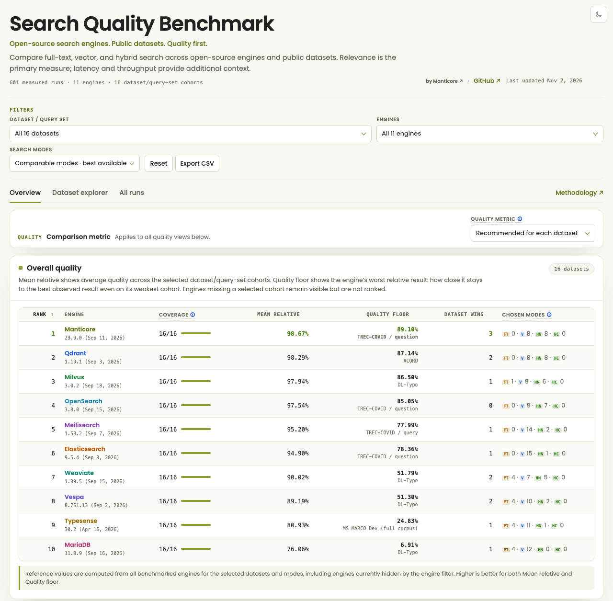
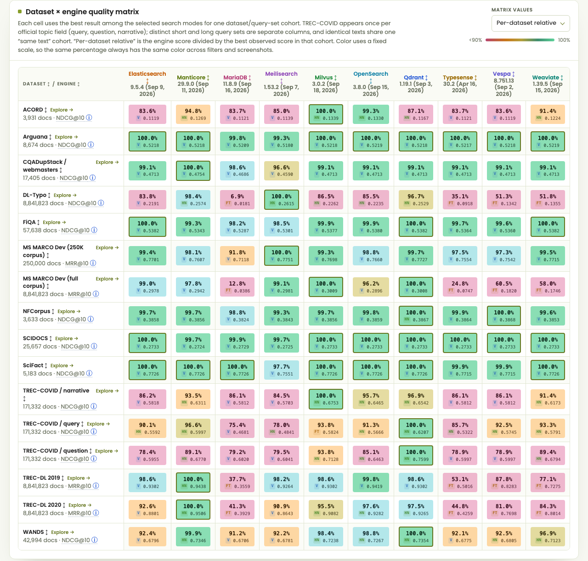

# Search Quality Benchmark

Open-source search engines compared on ranking quality. Full-text, vector, and
hybrid search, run on public information-retrieval datasets with relevance
judgments, reported as one standalone interactive page.

**[Open the interactive report](https://search-quality-benchmark.manticoresearch.com)** · 601 runs · 11 engines ·
16 dataset/query-set cohorts · updated 2026-11-02

> [!NOTE]
> Search Quality Benchmark is maintained by [Manticore](https://manticoresearch.com/), the
> team behind Manticore Search, which is one of the benchmarked engines. Every
> engine profile is in this repository, every run writes its per-query results,
> and the engine images are pinned in [`compose.yaml`](compose.yaml), so any
> number here can be checked and rerun. The report will be published on a
> manticoresearch.com subdomain; until then, open `docs/index.html` locally.

## Results



Default report view: all 16 cohorts, best available comparable mode per
engine and cohort (full-text, vector, or engine-native hybrid), recommended
metric per dataset (NDCG@10, MRR@10 for MS MARCO and TREC-DL).

| Rank | Engine | Mean relative | Quality floor | Dataset wins |
| ---: | --- | ---: | ---: | ---: |
| 1 | Manticore Search 29.9.0 | 98.67% | 89.10% | 3 |
| 2 | Qdrant 1.19.1 | 98.29% | 87.14% | 2 |
| 3 | Milvus 3.0.2 | 97.94% | 86.50% | 1 |
| 4 | OpenSearch 3.8.0 | 97.54% | 85.05% | 0 |
| 5 | Meilisearch 1.53.2 | 95.20% | 77.99% | 1 |
| 6 | Elasticsearch 9.5.4 | 94.90% | 78.36% | 1 |
| 7 | Weaviate 1.39.5 | 90.02% | 51.79% | 2 |
| 8 | Vespa 8.751.13 | 89.19% | 51.30% | 2 |
| 9 | Typesense 30.2 | 80.93% | 24.83% | 1 |
| 10 | MariaDB 11.8.9 | 76.06% | 6.91% | 1 |

- **Mean relative**: average over cohorts of `engine_score / best_score` on
  that cohort. 100% means the engine won everywhere.
- **Quality floor**: the engine's worst cohort, relative to the best result on
  it. It shows how far an engine falls on its weakest workload.
- **Dataset wins**: cohorts where the engine matches the best observed score.
- SereneDB 26.10.1 is benchmarked but unranked in the default view: its hybrid
  mode is fused by the benchmark client, not by the engine, and such runs are
  an explicit opt-in in the report.



Every cell is the engine's best comparable result on that cohort, as a share of
the best score observed there. The badge shows the winning mode: `FT`
full-text, `V` vector, `HN` native hybrid. Filters for datasets, engines,
search modes, and metric change every view, and the filter state lives in the
URL, so a specific comparison can be linked.

## Methodology

Every engine gets identical inputs for a dataset:

- the same prepared corpus, queries, and relevance judgments;
- the same document and query embeddings, read from one shared cache
  (`qwen/qwen3-embedding-8b`, so vector results reflect one model plus each
  engine's index and quantization settings);
- the same run settings: top 100 results, 5 warm-up queries, concurrency 1,
  one repeat;
- the same query text in every mode of a run. For TREC-COVID that is the
  selected official topic field, in both hybrid branches too.

Engine settings are not identical. Each profile in [`config.yaml`](config.yaml)
picks that engine's options (ranking profile, quantization, fusion weights), and
each run records them, so the report can show them per result.

**Quality metrics**: NDCG@10, NDCG@20, MRR@10, MAP@10, P@20, Recall@100 against
the dataset qrels. NDCG uses graded relevance; MAP and Recall count any
relevance above zero. The report ranks engines on NDCG@10, or MRR@10 for
MS MARCO and TREC-DL; a selector applies any single metric to all cohorts.

**Ranking rule**: for each cohort, `relative = engine_score / best_observed_score`;
each dataset family has equal weight, and the three TREC-COVID views share one
family's weight. An engine is ranked only when it has a completed result on
every selected cohort; others stay visible with their coverage. Reference
winners come from the full engine set and do not change when an engine is
filtered out.

**Hybrid**: *native* means the engine fused its lexical and vector candidates
itself (Elasticsearch, Manticore, Meilisearch, Milvus, OpenSearch, Qdrant,
Typesense, Vespa, Weaviate, and MariaDB via one server-side SQL statement).
*Non-native* means the benchmark client fetched two result sets and fused them
with reciprocal-rank fusion. Non-native runs are hidden by default and carry a
comparability warning when enabled.

**Performance** (P50, P95, P99 latency, QPS, error rate) is measured by the
Python client around each request at concurrency 1. It is context for the
quality numbers, not a load test, and does not affect ranking.

## Engines

All 11 engines run full-text, vector, and hybrid profiles from the pinned
images in [`compose.yaml`](compose.yaml).

| Engine | Image | Notes |
| --- | --- | --- |
| Manticore Search | `manticoresearch/manticore:29.9.0` | Report shows the `columnar` profiles (`engine='columnar'`); row-wise `manticore` profiles are excluded |
| Elasticsearch | `docker.elastic.co/elasticsearch/elasticsearch:9.5.4` | 1 GB JVM heap in the bundled service |
| OpenSearch | `opensearchproject/opensearch:3.8.0` | k-NN plugin from the image; native `hybrid` query with weighted RRF |
| Meilisearch | `getmeili/meilisearch:v1.53.2` | Lexical ranking is not BM25; treat it as a separate retrieval model |
| Typesense | `typesense/typesense:30.2` | |
| Qdrant | `qdrant/qdrant:v1.19.1` | Full-text mode is BM25 sparse vectors (`Qdrant/bm25`); native Query API RRF for hybrid |
| Milvus | `milvusdb/milvus:v3.0.2` | Native BM25 over concatenated text fields; native RRF for hybrid |
| MariaDB | `mariadb:11.8.9` | `MATCH ... AGAINST`, `VECTOR INDEX`, weighted RRF in one server-side SQL statement |
| SereneDB | `serenedb/serenedb:26.10.1` | Exact vector scans (ANN path crashed on repeated 4096-dim queries); hybrid fused client-side |
| Weaviate | `cr.weaviate.io/semitechnologies/weaviate:1.39.5` | |
| Vespa | `vespaengine/vespa:8.751.13` | |

## Datasets

| Dataset | Source ID | Documents | Metric |
| --- | --- | ---: | --- |
| ACORD | `hf-beir:theatticusproject/acord:test` | 3,931 | NDCG@10 |
| Arguana | `beir/arguana` | 8,674 | NDCG@10 |
| CQADupStack / webmasters | `beir/cqadupstack/webmasters` | 17,405 | NDCG@10 |
| DL-Typo | `dl-typo` | 8,841,823 | NDCG@10 |
| FiQA | `beir/fiqa/test` | 57,638 | NDCG@10 |
| MS MARCO Dev, 250K subset | `msmarco-passage/dev/small` | 250,000 | MRR@10 |
| MS MARCO Dev, full corpus | `msmarco-passage/dev/small` | 8,841,823 | MRR@10 |
| NFCorpus | `beir/nfcorpus/test` | 3,633 | NDCG@10 |
| SCIDOCS | `beir/scidocs` | 25,657 | NDCG@10 |
| SciFact | `beir/scifact/test` | 5,183 | NDCG@10 |
| TREC-COVID: query, question, narrative | `beir/trec-covid` | 171,332 | NDCG@10 |
| TREC-DL 2019 | `msmarco-passage/trec-dl-2019/judged` | 8,841,823 | MRR@10 |
| TREC-DL 2020 | `msmarco-passage/trec-dl-2020/judged` | 8,841,823 | MRR@10 |
| WANDS | `wands` | 42,994 | NDCG@10 |

Sources: [ir_datasets](https://ir-datasets.com/) (BEIR, MS MARCO, TREC-DL),
[WANDS](https://github.com/wayfair/WANDS),
[ACORD](https://huggingface.co/datasets/theatticusproject/acord), and the
DL-Typo queries from [CharacterBERT-DR](https://github.com/ielab/CharacterBERT-DR).
The 250K MS MARCO subset is deterministic and keeps every judged document.
TREC-COVID is three cohorts over one corpus and one set of judgments, one per
official topic field: `query` (short keywords), `question` (natural-language
question), and `narrative` (long description).

## Limitations

- **Not a load test.** Concurrency 1, one repeat. QPS is a single client's
  observed rate; one repeat cannot estimate variance, so treat small quality
  and latency gaps cautiously. Latency includes the Python client and the local
  network round trip.
- **Hardware is not recorded.** All engines run as single-node Docker
  containers on one host; `compose.yaml` sets no CPU or memory limits.
  Elasticsearch uses a 1 GB JVM heap, and MariaDB defaults to a 32 GiB InnoDB
  buffer pool and an 8 GiB HNSW cache.
- **Indexing is not compared.** No indexing time, memory, or disk footprint.
- **One embedding model.** Documents the model cannot embed are skipped in
  vector indexes, so full-text and vector row counts can differ slightly.
- **Profiles, not best possible setups.** Results reflect the bundled
  profiles, not each vendor's optimal tuning.
- **A missing cell** means no completed run; it does not say whether the
  operation is unsupported or the run was aborted.

## Run it yourself

<details>
<summary>Requirements, install, and a first benchmark</summary>

Requirements: Python 3.11+, Docker with Docker Compose, and an embedding API
key (OpenRouter for the bundled profiles; `openai` is also supported).
`prepare` embeds every document and query missing from the vector cache, so the
key is needed even before full-text-only runs.

```bash
git clone https://github.com/manticoresoftware/search-quality-benchmark.git
cd search-quality-benchmark
python3 -m venv .venv
source .venv/bin/activate
pip install -e '.[dev]'
```

Point `embedding.api_key_file` in `config.yaml` to a file containing the key.
Do not paste the key into `config.yaml`: that file is tracked in Git.

```yaml
embedding:
  provider: "openrouter"
  model: "qwen/qwen3-embedding-8b"
  api_key_file: "/absolute/path/to/keyfile"
```

A small benchmark, Manticore full-text on SciFact (5,183 documents):

```bash
docker compose up -d manticore
bench prepare --entry scifact_columnar_fulltext
bench index --engine columnar --mode fulltext --entry scifact_columnar_fulltext
bench run --engine columnar --mode fulltext --entry scifact_columnar_fulltext
bench report
```

`bench` without arguments opens an interactive menu with the same steps:
`engines`, `prepare`, `index`, `run`, `report`. Profile names follow
`<dataset>_<engine>_<mode>`; `config.yaml` lists every runnable profile and
[`config.yaml.template`](config.yaml.template) documents every option.

Each run writes `artifacts/<run_id>/` with `metrics.json`, `per_query.csv`,
`summary.md`, and `diagnostics.json`. `bench report` compares selected runs as
Markdown plus a standalone `index.html`. The complete report in
[`docs/index.html`](docs/index.html) is rebuilt from every eligible artifact
with:

```bash
python3 src/bench/interactive_report.py
```

Engine ports, credentials, host directories that need permissions before first
start (OpenSearch, Elasticsearch, Milvus, Vespa), configuration inheritance, and
backend details are in [`AGENTS.md`](AGENTS.md).

</details>

## Contributing

Bug reports, fixes, and new engine profiles are welcome under the Manticore
[contribution guidelines](https://github.com/manticoresoftware/manticoresearch/blob/main/CONTRIBUTING.md).
An engine integration is a backend module in `src/bench/`, a pinned service in
`compose.yaml`, and profiles in `config.yaml`; [`AGENTS.md`](AGENTS.md) is the
maintainer reference. Unit tests: `./.venv/bin/pytest -q tests/unit`.

## Security

- Keep API keys in files referenced by `api_key_file` or `token_file`, outside
  the repository.
- The bundled services are local benchmark setups: most run without
  authentication or with fixed development credentials, and Compose publishes
  their ports on every host interface. Run them only on a trusted host and
  network.
- Report vulnerabilities privately through the Manticore
  [security advisory form](https://github.com/manticoresoftware/manticoresearch/security/advisories/new).

## License

The original code and documentation are licensed under the [MIT License](LICENSE).
Bundled Poppins fonts retain their [SIL Open Font License 1.1](src/bench/report_fonts/OFL.txt).
Dependencies, search engines, datasets, and models retain their own licenses and
terms; see [third-party notices](THIRD_PARTY_NOTICES.md).
